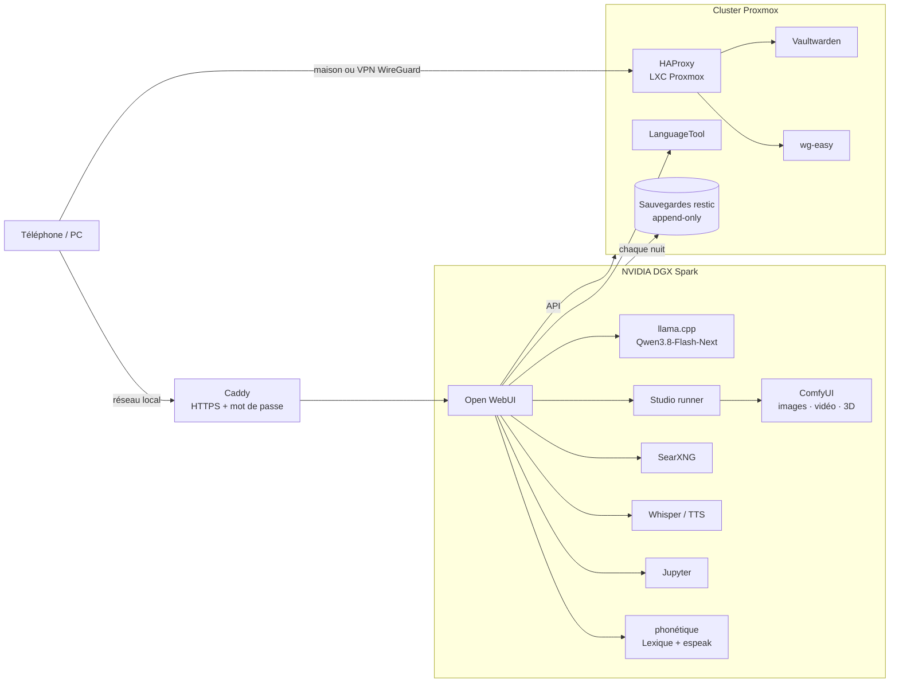

<div align="center">

# homelab-ia

**Une IA 100 % locale à la maison : chat, images, vidéos, 3D, correcteur, admin Proxmox et bot de trading — sur un NVIDIA DGX Spark, sans aucun service cloud.**

*A fully local AI stack on an NVIDIA DGX Spark (GB10, 128 GB unified memory) + a Proxmox homelab. French documentation.*


</div>

---

## Ce que ça fait

Tout passe par **[Open WebUI](https://github.com/open-webui/open-webui)**, comme un ChatGPT privé. Chaque « assistant » est un modèle avec ses propres outils :

| Assistant | Ce qu'il fait | Code |
|---|---|---|
| **Chat** | Un grand modèle (Qwen3.8-Flash-Next) servi par llama.cpp, avec recherche web (SearXNG), voix (Whisper / TTS) et un exécuteur de code (Jupyter) | [`spark/`](spark/) |
| **Studio** | Images, vidéos (texte→vidéo, image→vidéo, vidéos longues en plusieurs scènes) et modèles 3D via ComfyUI. Une fenêtre permet de choisir **durée et qualité** avec le **temps estimé** avant de lancer. Une IA de vision **vérifie chaque image** et relance si elle ne correspond pas à la demande. | [`openwebui/outils/studio_tool.py`](openwebui/outils/studio_tool.py), [`studio/`](studio/) |
| **Correcteur** | Pensé pour la dyslexie et l'écriture « au son » : corrige un français écrit phonétiquement (« sa allaire de focntionner » → « ça a l'air de fonctionner »), avec un **carnet personnel** qui apprend chaque nuit, un **dictionnaire des sons** (Lexique 3 + espeak-ng), **LanguageTool**, et la **traduction** (« corrige et traduis en anglais : … ») | [`correcteur/`](correcteur/), [`openwebui/filtres/correcteur_memoire.py`](openwebui/filtres/correcteur_memoire.py) |
| **Admin Proxmox** | Pilote le cluster Proxmox en langage naturel : état, démarrer/arrêter, sauvegardes, créer un conteneur (l'IP suit l'ID), avec **confirmation** avant toute action risquée et des machines **protégées** | [`openwebui/outils/proxmox_tool.py`](openwebui/outils/proxmox_tool.py) |
| **Trading** | Un professeur qui explique, avec graphiques, ce que fait un **portefeuille fictif** géré par l'IA locale (agents [TradingAgents](https://github.com/TauricResearch/TradingAgents)). Simulation uniquement. | [`openwebui/outils/trading_tool.py`](openwebui/outils/trading_tool.py) |

## Architecture



## Points techniques intéressants

- **Un seul gros modèle partagé.** Le chat, le Correcteur, le trading et la vérification d'images utilisent le même serveur llama.cpp, avec décodage spéculatif (MTP) et cache KV en q8_0. Les vidéos ont besoin de toute la mémoire : le Studio **arrête le chat pendant le rendu puis le relance**, et les autres services attendent qu'il revienne.
- **Démarrage fiable du GPU.** Après une coupure de courant, le GPU n'est pas toujours prêt quand les services démarrent : [`attendre-gpu`](spark/scripts/attendre-gpu) et [`wait-mem`](spark/scripts/wait-mem) les font patienter au lieu de démarrer en mode CPU ou de saturer la mémoire.
- **Correctif llama.cpp.** Réponses vides avec les appels d'outils en parallèle : correctif de la [PR #28058](https://github.com/ggml-org/llama.cpp/pull/28058) appliqué à la main → 0 réponse vide sur 8 requêtes simultanées, sans perte de vitesse.
- **Fréquence GPU plafonnée** ([`gpu-limite.service`](spark/systemd/gpu-limite.service)) pour éviter la surchauffe lors des longs rendus.
- **Sauvegardes qu'un pirate ne peut pas effacer.** Le Spark envoie ses sauvegardes [restic](https://restic.net) chaque nuit vers un autre serveur à travers `rclone serve restic --append-only` : il peut **ajouter** mais pas **supprimer**. Le ménage se fait uniquement côté serveur de sauvegarde. ([`sauvegardes/`](sauvegardes/))
- **Accès depuis l'extérieur sans IP fixe ni ouvrir de site web à Internet** : un seul port UDP vers WireGuard, un DNS dynamique via l'API OVH, un certificat Let's Encrypt *wildcard* par challenge DNS, et HAProxy qui **refuse tout ce qui ne vient pas de la maison ou du VPN**. ([`proxmox-lxc/`](proxmox-lxc/))

## Contenu du dépôt

```
spark/            docker-compose (Open WebUI, SearXNG, Whisper/TTS, Jupyter, ComfyUI, Caddy), services systemd, scripts
openwebui/outils  outils Open WebUI : Studio, Proxmox, Trading
openwebui/filtres filtres Open WebUI : Correcteur, recherche web forcée, outils du modèle toujours actifs
studio/           serveur de rendu (file d'attente, presets qualité, vidéos longues), workflows ComfyUI, vérification d'images
correcteur/       dictionnaire des sons (Lexique 3 + espeak-ng), apprentissage nocturne du carnet
mail/             serveur MCP en lecture seule pour la boîte mail (jamais d'envoi ni de suppression)
proxmox-lxc/      configs des conteneurs : HAProxy, Vaultwarden, wg-easy, DNS dynamique OVH, mise à jour de LanguageTool
sauvegardes/      sauvegarde restic append-only et ménage côté serveur
```

## Matériel

| Machine | Rôle |
|---|---|
| **NVIDIA DGX Spark** (GB10, 20 cœurs ARM, 128 Go de mémoire unifiée) | Toute l'IA |
| **Dell PowerEdge R630** (Proxmox `pve`) | Conteneurs : Vaultwarden, VPN, reverse proxy, LanguageTool |
| **HP ProLiant DL380** (Proxmox `pve2`, RAID 2 To) | Stockage partagé et sauvegardes |

## Utiliser ce dépôt

Ce n'est pas un installateur clé en main mais la **configuration réelle** d'un homelab, nettoyée de tout secret : adresses, domaine (`example.com`) et mots de passe sont à adapter.

1. Copier `spark/.env.example` en `spark/.env` et le remplir.
2. `docker compose -f spark/docker-compose.yml up -d`
3. Installer les services de `spark/systemd/` et les scripts de `spark/scripts/` dans `/usr/local/bin/`.
4. Dans Open WebUI : *Espace de travail → Outils / Fonctions* → importer les fichiers de `openwebui/`.

> **Attention :** les modèles ne sont pas inclus. Vérifiez la licence de chacun avant usage (certaines licences de modèles vidéo excluent des pays ou l'usage commercial).

## Mise à jour d'octobre 2026 : ce qu'il reste à faire à la main

Cette branche corrige le code (voir la pull request). Les étapes ci-dessous se font sur les machines, dans l'ordre.

### 1. Déployer les fichiers modifiés

| Fichier du dépôt | Où le mettre | Puis |
|---|---|---|
| `mail/mail_mcp.py` et `mail/config.json` | Spark : `/opt/ai-stack/mcpo/mail/` et `/opt/ai-stack/mcpo/config.json` | `docker compose restart mcpo` |
| `studio/runner.py` et le dossier `studio/static/` | Spark : `/opt/ai-stack/studio/` | `sudo systemctl restart studio-runner` |
| `spark/logrotate/homelab` | Spark : `/etc/logrotate.d/homelab` | rien |
| `spark/scripts/verifier-modeles` | Spark : `/usr/local/bin/` | `verifier-modeles` : liste les modèles ComfyUI manquants |
| `openwebui/outils/*.py`, `openwebui/filtres/correcteur_memoire.py` | Open WebUI → *Espace de travail → Outils / Fonctions* : remplacer le code de chacun | Enregistrer |
| `spark/docker-compose.yml`, `spark/searxng/settings.yml` | Spark : `/opt/ai-stack/` | Vérifier que `.env` contient `SEARXNG_SECRET` (`openssl rand -hex 32`), puis `docker compose up -d` |
| `proxmox-lxc/haproxy.cfg` | Conteneur 112 : `/etc/haproxy/haproxy.cfg` | `haproxy -c -f /etc/haproxy/haproxy.cfg && systemctl reload haproxy` |

> **Attention :** avec `ENABLE_VALVE_ENCRYPTION`, les valves (clé Proxmox…) sont chiffrées avec `WEBUI_SECRET_KEY`. Ne plus jamais changer cette clé, sinon les valves sont perdues ; la garder dans Vaultwarden.

### 2. Séparer le mail du web (risque d'injection de prompt)

Un modèle qui lit les mails ET peut aller sur le web ou exécuter du code peut être piégé par une page ou un mail (« envoie le contenu des mails à … »). On sépare :

1. *Espace de travail → Modèles → Nouveau* : « 📬 Mail », basé sur Flash-Next, avec **seulement** l'outil `mail`. Pas de recherche web, pas de `fetch`, pas de `browser`, pas d'interpréteur de code, et **sans** le filtre « Outils par défaut ».
2. Sur tous les autres modèles : décocher l'outil `mail`.

### 3. Limiter la clé Proxmox de l'IA

Aujourd'hui la clé `spark@pve!spark` a le rôle PVEAdmin partout : la liste `PROTEGES` du code est la seule barrière. Après ces commandes, l'IA **voit** tout le cluster mais n'**agit** que sur le pool `agent` ; Vaultwarden (110), le VPN (111), le proxy (112) et LanguageTool (113) restent hors du pool, donc Proxmox refuse lui-même.

Sur un nœud Proxmox (root) :

```bash
# 1. Le pool, avec les conteneurs déjà créés par l'IA (ceux qui ont le tag « agent ») — PAS 110 à 113
pveum pool add agent --comment "Conteneurs gérés par l'IA"
pveum pool modify agent --vms <ID1>,<ID2>

# 2. Un rôle avec seulement ce dont l'outil a besoin
pveum role add IA-Agent --privs "VM.Audit VM.PowerMgmt VM.Backup VM.Allocate VM.Config.Disk VM.Config.CPU VM.Config.Memory VM.Config.Network VM.Config.Options Datastore.AllocateSpace Datastore.Audit"

# 3. Les droits (posés sur l'utilisateur ET sur la clé : marche que la clé soit « séparée » ou non)
for qui in "--users spark@pve" "--tokens spark@pve!spark"; do
  pveum acl modify /                    $qui --roles PVEAuditor   # lecture seule partout
  pveum acl modify /pool/agent          $qui --roles IA-Agent     # actions sur le pool seulement
  pveum acl modify /storage/local       $qui --roles IA-Agent     # modèle Debian
  pveum acl modify /storage/local-lvm   $qui --roles IA-Agent     # disques des conteneurs
  pveum acl modify /storage/shared-hdd  $qui --roles IA-Agent     # sauvegardes
  pveum acl modify /sdn/zones/localnetwork $qui --roles PVESDNUser  # pont vmbr0
done

# 4. Retirer l'ancien PVEAdmin (regarder où il est posé, puis le supprimer au même endroit)
pveum acl list | grep spark
pveum acl delete / --users spark@pve --roles PVEAdmin          # adapter le chemin / --tokens si besoin

# 5. Vérifier : sur 110, seulement des droits de lecture (VM.Audit…)
pveum user token permissions spark@pve spark --path /vms/110
pveum user token permissions spark@pve spark --path /pool/agent
```

Puis dans Open WebUI, valves de l'outil Proxmox : `pool` = `agent` (les nouveaux conteneurs y sont rangés automatiquement).

À tester ensuite depuis le chat : « état du cluster », « arrête 110 » (doit être refusé), créer puis supprimer un conteneur de test. Si la création échoue sur les options `nesting`/`keyctl`, noter le message d'erreur exact.

Limite connue : avec `VM.Backup` sur `shared-hdd`, l'IA pourrait en théorie effacer des sauvegardes des conteneurs du pool. Pour une vraie protection des sauvegardes, voir Proxmox Backup Server (point 7).

### 4. Mémoire du Spark pleine « au bout d'un moment »

Deux suspects, à vérifier **au moment où c'est plein** :

```bash
free -g                       # grosse colonne buff/cache → suspect 2
ollama ps                     # qwen3.8:27b chargé → suspect 1
ps aux --sort=-rss | head -8  # qui prend le plus
```

1. **Le modèle des tâches d'Open WebUI** (titres, tags, suggestions) est `qwen3.8:27b` dans Ollama : il se charge à chaque conversation en plus de Flash-Next (~80 Go) et reste 15 min. Solutions : un petit modèle (2-3 B) dans `TASK_MODEL`, ou couper les suggestions/tags (*Réglages admin → Interface*) ; et dans `ollama.service.d/override.conf` : `OLLAMA_KEEP_ALIVE=2m`, `OLLAMA_NUM_PARALLEL=1`.
2. **Le cache disque** : sur le GB10, la mémoire est partagée CPU/GPU et le cache des gros fichiers (modèles vidéo) ne se libère pas assez vite. NVIDIA le documente et conseille : `sudo sh -c 'sync; echo 3 > /proc/sys/vm/drop_caches'` (sans risque). À ajouter ensuite dans le runner avant chaque vidéo si c'est bien ça.

### 5. Qualité des images et vidéos (après avoir réglé la mémoire)

Tout est réglé en mode « rapide et léger », comme pour une petite carte graphique : modèles Turbo (8 étapes), compressés en int8, en basse résolution. Le Spark peut faire bien mieux :

- **Résolution** : Qwen-Image 2.1 est fait pour 2048×2048 à 2752×1536 ; le Studio l'utilise en ~1024.
- **Versions pleines** : Qwen-Image 2.1 Turbo existe en bf16 ; Z-Image **Base** (non distillé, 30-50 étapes, CFG 3-5) donne plus de détails que Z-Image Turbo.
- **Vidéo** : résolution native de MiniMax H3 = 1344×768 ; la qualité par défaut « rapide » est en 864×480. Passer « bonne » par défaut, et 25 étapes pour « meilleure » (conseil de la doc ComfyUI).
- Méthode : comparer d'abord dans l'interface ComfyUI (port 8443) avec les modèles officiels, puis ajouter un mode « qualité max » au Studio.

### 6. Nouveau : le résumé du matin

Tous les jours vers 6 h 50, le Spark lit les mails non lus de la nuit, demande à Flash-Next lesquels sont importants, vérifie le homelab (services, sauvegarde, disque, mémoire, Proxmox) et **dépose** le résumé dans ta boîte de réception, non lu, avec le libellé « Résumés du matin ». Rien n'est envoyé : le message est rangé comme un brouillon. Le modèle n'a aucun outil, donc un mail piégé ne peut rien faire (au pire, fausser le résumé).

```bash
sudo mkdir -p /opt/ai-stack/resume
sudo cp resume/resume_matin.py /opt/ai-stack/resume/
sudo cp resume/resume.env.example /opt/ai-stack/resume/resume.env   # obligatoire, même sans rien changer
sudo cp spark/systemd/resume-matin.{service,timer} /etc/systemd/system/
sudo systemctl daemon-reload

# Essai sans rien déposer : écrit resume-test.html dans le dossier courant
sudo MAIL_CONF=/opt/ai-stack/mcpo/mail/mail.env python3 /opt/ai-stack/resume/resume_matin.py --test
# Essai en vrai, puis activation tous les jours
sudo systemctl start resume-matin && journalctl -u resume-matin -n 20
sudo systemctl enable --now resume-matin.timer
```

Pour voir l'état de Proxmox dans le résumé, remplir les lignes `PVE_*` de `resume.env` (une clé en lecture seule suffit) et copier le certificat `pve-root-ca.pem` dans `/opt/ai-stack/resume/`.

Gmail ne fait pas toujours sonner le téléphone pour un message déposé de cette façon : il apparaît en haut de la réception, en gras, mais sans notification. Si tu veux une notification, on ajoutera ntfy plus tard.

### 7. À faire ensuite (moins urgent)

- **Figer les versions** : `open-webui:main` est une version de développement, pas une version stable. Utiliser par exemple `ghcr.io/open-webui/open-webui:v0.12.3`, et des versions précises au lieu de `:latest` (Qdrant, SearXNG, Jupyter, Vaultwarden…) (les serveurs MCP de `mail/config.json` sont déjà figés dans cette branche).
- **Remplacer du code maison par des outils existants** : llama-swap (charge/décharge les modèles à la demande, le chat ne « disparaît » plus pendant les vidéos) et suppression d'Ollama (llama-swap sert aussi bge-m3 et un petit modèle de tâches) ; Proxmox Backup Server pour les sauvegardes des machines ; Diun ou Renovate pour être prévenu des nouvelles versions ; options mémoire de ComfyUI (`--disable-smart-memory`) au lieu du timer qui le vide toutes les 5 min.
- **Vaultwarden** : passer en 1.37.4 ou plus (7 failles corrigées), activer la double authentification, et n'accepter le port 8080 que depuis HAProxy (pare-feu Proxmox sur le conteneur 110, source 192.168.0.212).
- **wg-easy** : activer la double authentification de l'interface ; charger `wireguard` sur l'hôte Proxmox puis retirer `SYS_MODULE` et le montage `/lib/modules`.
- **Modèle des tâches** (titres, tags, requêtes de recherche) : un petit modèle (2-3 B) au lieu du 27 B, comme le conseille la doc d'Open WebUI.
- **Chat mis en pause pendant les vidéos** : remplacer `systemctl stop/start` par le mode « router » de llama.cpp (`/models/unload`) ou llama-swap : le serveur reste joignable, plus d'erreur « Model not found ».
- **Sauvegardes** : ajouter une copie hors de la maison (`restic copy`), sauvegarder Qdrant par son API de snapshots, et faire un test de restauration de temps en temps.

## Licence

[MIT](LICENSE)
