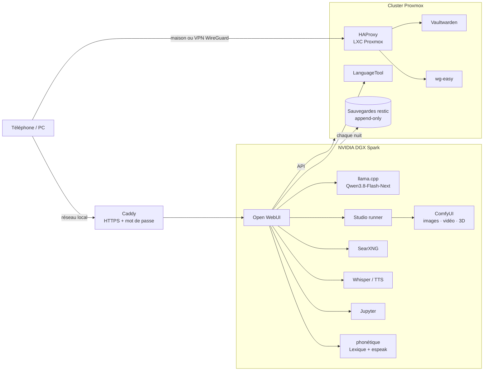

<div align="center">

# homelab-ia

**Une IA 100 % locale à la maison : chat, images, vidéos, 3D, correcteur, admin Proxmox et bot de trading — sur un NVIDIA DGX Spark, sans aucun service cloud.**

*A fully local AI stack on an NVIDIA DGX Spark (GB10, 128 GB unified memory) + a Proxmox homelab. French documentation.*


</div>

---

## Ce que ça fait

Tout passe par **[Open WebUI](https://github.com/open-webui/open-webui)**, comme un ChatGPT privé. Chaque « assistant » est un modèle avec ses propres outils :

| Assistant | Ce qu'il fait | Code |
|---|---|---|
| **Chat** | Un grand modèle (Qwen3.8-Flash-Next) servi par llama.cpp, avec recherche web (SearXNG), voix (Whisper / TTS) et un exécuteur de code (Jupyter) | [`spark/`](spark/) |
| **Studio** | Images, vidéos (texte→vidéo, image→vidéo, vidéos longues en plusieurs scènes) et modèles 3D via ComfyUI. Une fenêtre permet de choisir **durée et qualité** avec le **temps estimé** avant de lancer. Une IA de vision **vérifie chaque image** et relance si elle ne correspond pas à la demande. | [`openwebui/outils/studio_tool.py`](openwebui/outils/studio_tool.py), [`studio/`](studio/) |
| **Correcteur** | Pensé pour la dyslexie et l'écriture « au son » : corrige un français écrit phonétiquement (« sa allaire de focntionner » → « ça a l'air de fonctionner »), avec un **carnet personnel** qui apprend chaque nuit, un **dictionnaire des sons** (Lexique 3 + espeak-ng), **LanguageTool**, et la **traduction** (« corrige et traduis en anglais : … ») | [`correcteur/`](correcteur/), [`openwebui/filtres/correcteur_memoire.py`](openwebui/filtres/correcteur_memoire.py) |
| **Admin Proxmox** | Pilote le cluster Proxmox en langage naturel : état, démarrer/arrêter, sauvegardes, créer un conteneur (l'IP suit l'ID), avec **confirmation** avant toute action risquée et des machines **protégées** | [`openwebui/outils/proxmox_tool.py`](openwebui/outils/proxmox_tool.py) |
| **Trading** | Un professeur qui explique, avec graphiques, ce que fait un **portefeuille fictif** géré par l'IA locale (agents [TradingAgents](https://github.com/TauricResearch/TradingAgents)). Simulation uniquement. | [`openwebui/outils/trading_tool.py`](openwebui/outils/trading_tool.py) |

## Architecture



## Points techniques intéressants

- **Un seul gros modèle partagé.** Le chat, le Correcteur, le trading et la vérification d'images utilisent le même serveur llama.cpp, avec décodage spéculatif (MTP) et cache KV en q8_0. Les vidéos ont besoin de toute la mémoire : le Studio **arrête le chat pendant le rendu puis le relance**, et les autres services attendent qu'il revienne.
- **Démarrage fiable du GPU.** Après une coupure de courant, le GPU n'est pas toujours prêt quand les services démarrent : [`attendre-gpu`](spark/scripts/attendre-gpu) et [`wait-mem`](spark/scripts/wait-mem) les font patienter au lieu de démarrer en mode CPU ou de saturer la mémoire.
- **Correctif llama.cpp.** Réponses vides avec les appels d'outils en parallèle : correctif de la [PR #28058](https://github.com/ggml-org/llama.cpp/pull/28058) appliqué à la main → 0 réponse vide sur 8 requêtes simultanées, sans perte de vitesse.
- **Fréquence GPU plafonnée** ([`gpu-limite.service`](spark/systemd/gpu-limite.service)) pour éviter la surchauffe lors des longs rendus.
- **Sauvegardes qu'un pirate ne peut pas effacer.** Le Spark envoie ses sauvegardes [restic](https://restic.net) chaque nuit vers un autre serveur à travers `rclone serve restic --append-only` : il peut **ajouter** mais pas **supprimer**. Le ménage se fait uniquement côté serveur de sauvegarde. ([`sauvegardes/`](sauvegardes/))
- **Accès depuis l'extérieur sans IP fixe ni ouvrir de site web à Internet** : un seul port UDP vers WireGuard, un DNS dynamique via l'API OVH, un certificat Let's Encrypt *wildcard* par challenge DNS, et HAProxy qui **refuse tout ce qui ne vient pas de la maison ou du VPN**. ([`proxmox-lxc/`](proxmox-lxc/))

## Contenu du dépôt

```
spark/            docker-compose (Open WebUI, SearXNG, Whisper/TTS, Jupyter, ComfyUI, Caddy), services systemd, scripts
openwebui/outils  outils Open WebUI : Studio, Proxmox, Trading
openwebui/filtres filtres Open WebUI : Correcteur, recherche web forcée, outils du modèle toujours actifs
studio/           serveur de rendu (file d'attente, presets qualité, vidéos longues), workflows ComfyUI, vérification d'images
correcteur/       dictionnaire des sons (Lexique 3 + espeak-ng), apprentissage nocturne du carnet
mail/             serveur MCP en lecture seule pour la boîte mail (jamais d'envoi ni de suppression)
proxmox-lxc/      configs des conteneurs : HAProxy, Vaultwarden, wg-easy, DNS dynamique OVH, mise à jour de LanguageTool
sauvegardes/      sauvegarde restic append-only et ménage côté serveur
```

## Matériel

| Machine | Rôle |
|---|---|
| **NVIDIA DGX Spark** (GB10, 20 cœurs ARM, 128 Go de mémoire unifiée) | Toute l'IA |
| **Dell PowerEdge R630** (Proxmox `pve`) | Conteneurs : Vaultwarden, VPN, reverse proxy, LanguageTool |
| **HP ProLiant DL380** (Proxmox `pve2`, RAID 2 To) | Stockage partagé et sauvegardes |

## Utiliser ce dépôt

Ce n'est pas un installateur clé en main mais la **configuration réelle** d'un homelab, nettoyée de tout secret : adresses, domaine (`example.com`) et mots de passe sont à adapter.

1. Copier `spark/.env.example` en `spark/.env` et le remplir.
2. `docker compose -f spark/docker-compose.yml up -d`
3. Installer les services de `spark/systemd/` et les scripts de `spark/scripts/` dans `/usr/local/bin/`.
4. Dans Open WebUI : *Espace de travail → Outils / Fonctions* → importer les fichiers de `openwebui/`.

> **Attention :** les modèles ne sont pas inclus. Vérifiez la licence de chacun avant usage (certaines licences de modèles vidéo excluent des pays ou l'usage commercial).

## Licence

[MIT](LICENSE)
