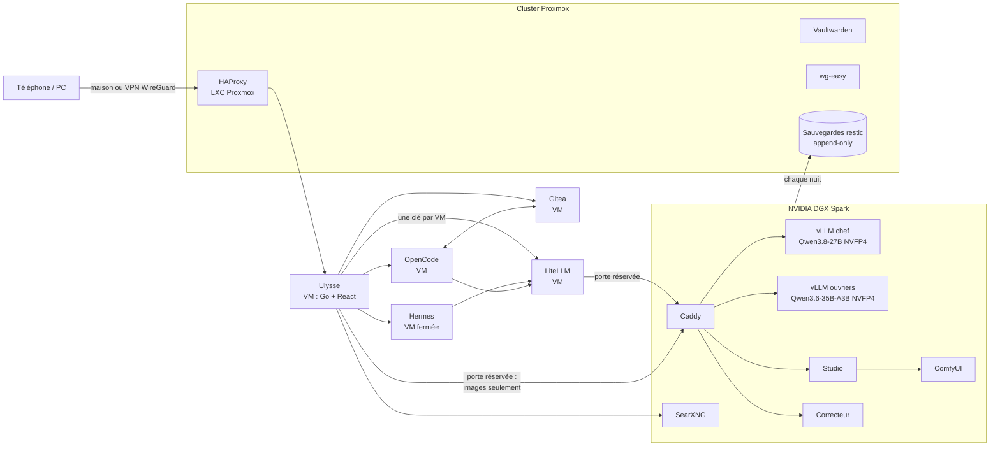

<div align="center">

# homelab-ia

**Une IA 100 % locale à la maison : une application de chat qui crée des images, se souvient, lit le code, agit avec ton accord et code en équipe. Sur un NVIDIA DGX Spark et un homelab Proxmox, sans aucun service cloud.**

*A fully local AI stack on an NVIDIA DGX Spark (GB10, 128 GB unified memory) + a Proxmox homelab: two vLLM servers, a LiteLLM gateway, a home-made chat app (Ulysse), an action agent (Hermes), coding agents (OpenCode) and a Gitea sandbox. French documentation.*


</div>

---

## Ce que ça fait

Tout tourne à la maison. Le cœur, c'est **Ulysse**, une application de chat faite maison (Go + React, dépôt privé),
accessible au téléphone par le VPN. Derrière, deux modèles servis par vLLM sur le DGX Spark :

- **le chef** : Qwen3.8-27B (NVFP4, décodage spéculatif MTP), pour parler, réfléchir et vérifier ;
- **les ouvriers** : Qwen3.6-35B-A3B (NVFP4, MTP), jusqu'à 32 agents en même temps, pour le code.

| Brique | Ce qu'elle fait | Code |
|---|---|---|
| **Ulysse** (chat) | Un seul chat : discussion avec recherche web, **images** (le chef écrit le prompt, Studio dessine, le chef vérifie), **mémoire** validée par l'utilisateur, recherche dans les anciennes discussions, lecture des projets Gitea, et les **actions** confiées à Hermes | dépôt privé |
| **Hermes** | L'assistant qui **agit** (VM de sa zone Proxmox, fichiers, OpenCode) dans une VM fermée ; chaque action sensible attend un « Oui » | [Hermes Agent](https://github.com/NousResearch/hermes-agent) + outils MCP maison (privés) |
| **Code** | Ulysse « chef d'orchestre » : l'architecte (le chef, dans OpenCode) prépare plan et tests verrouillés, des ouvriers font la course, Ulysse juge chaque essai, puis une pull request sur Gitea | [`opencode/agents/`](opencode/agents/), [`gitea/`](gitea/) |
| **Gitea** | Bac à sable des IA : copie de GitHub (branche principale protégée), les IA ne travaillent que sur leurs branches `ia/…` | [`gitea/`](gitea/) |
| **LiteLLM** | La seule porte vers les modèles : une clé par VM, en HTTPS | [`litellm/`](litellm/) |
| **Studio** | Images, vidéos et 3D par ComfyUI, avec une file d'attente et une vérification de chaque image | [`studio/`](studio/), [`openwebui/outils/studio_tool.py`](openwebui/outils/studio_tool.py) |
| **Correcteur** | Pensé pour la dyslexie et l'écriture « au son » (« sa allaire de focntionner » → « ça a l'air de fonctionner »), avec un carnet personnel qui apprend chaque nuit, un dictionnaire des sons et LanguageTool | [`correcteur/`](correcteur/), [`openwebui/filtres/correcteur_memoire.py`](openwebui/filtres/correcteur_memoire.py) |
| **Bot mail** | Lit les mails, propose des réponses ; **rien ne part** sans validation | [`mail/`](mail/) |
| **Open WebUI** | L'ancienne interface (avant Ulysse), encore en service pendant la transition ; ses outils sont dans [`openwebui/`](openwebui/) (l'admin Proxmox et le trading y sont des archives) | [`openwebui/`](openwebui/) |

## Architecture



## Points techniques intéressants

- **Deux vLLM sur un seul GPU.** Le chef et les ouvriers partagent le GB10. Quand le chef générait, les ouvriers *compilés* plantaient (Xid 31) en 15 s. Bissection complète : la cause était l'*async scheduling* combiné aux noyaux de réduction générés par Inductor ; réglé en passant à vLLM 0.34 (nightly). Tout est dans [`docs/vllm-deux-instances.md`](docs/vllm-deux-instances.md), avec les bancs de charge ([`spark/bancs/`](spark/bancs/)).
- **Une seule porte vers les IA : LiteLLM.** Les VM ne parlent jamais au Spark directement : une clé par VM, qu'on peut couper sans toucher aux autres. Chaque autre service a sa propre porte réservée (par exemple Studio : images seulement, jamais une vidéo qui arrêterait le chef).
- **Le chef d'orchestre et le jury caché.** Pour juger les ouvriers honnêtement, des tests de référence qu'aucune IA n'a vus sont lancés 50 fois chacun avec le détecteur de courses. Exemple : avec une limite de réponse de 32 768 jetons, le plan de l'architecte était parfois coupé (jury : 2 tests sur 6) ; à 65 536, le premier essai n'est pas coupé (5 sur 6). Un seul essai : à confirmer.
- **Rien sans « Oui ».** Les actions de Hermes, les mails, la mémoire du chat : le modèle **propose**, l'utilisateur **valide** sur une carte. Ce qui vient du web, d'un mail ou d'un dépôt est traité comme des données, jamais comme des ordres.
- **Démarrage fiable du GPU.** Après une coupure de courant, le GPU n'est pas toujours prêt : [`attendre-gpu`](spark/scripts/attendre-gpu) et [`wait-mem`](spark/scripts/wait-mem) font patienter les services au lieu de démarrer en mode CPU ou de saturer la mémoire.
- **Sauvegardes qu'un pirate ne peut pas effacer.** Le Spark envoie ses sauvegardes [restic](https://restic.net) chaque nuit à travers `rclone serve restic --append-only` : il peut **ajouter** mais pas **supprimer**. ([`sauvegardes/`](sauvegardes/))
- **Accès depuis l'extérieur sans IP fixe ni site ouvert à Internet** : un seul port UDP vers WireGuard, un DNS dynamique, un certificat Let's Encrypt *wildcard* par challenge DNS, et HAProxy qui **refuse tout ce qui ne vient pas de la maison ou du VPN**. ([`proxmox-lxc/`](proxmox-lxc/))
- **Avant novembre 2026** : un seul gros modèle (llama.cpp) servait tout, et le Studio l'arrêtait pendant les vidéos. Les fichiers de cette époque restent dans le dépôt pour l'historique (`spark/llama-swap/`, `spark/systemd/llama-flashnext.service`, la liste [`docs/archives/mise-a-jour-octobre-2026.md`](docs/archives/mise-a-jour-octobre-2026.md)).

## Contenu du dépôt

```
litellm/          passerelle LiteLLM (une clé par VM, HTTPS via Caddy) devant les deux vLLM du Spark
gitea/            bac à sable des IA : Gitea + synchro GitHub -> Gitea (main protégé, les IA sur leurs branches ia/…)
docs/             décisions techniques (deux vLLM sur un GPU)
spark/bancs/      scripts de charge et de vitesse pour vLLM
opencode/agents/  agents OpenCode : chef d'équipe, codeur, réflexion, relecteur
spark/            docker-compose (Open WebUI, SearXNG, Whisper/TTS, Jupyter, ComfyUI, Caddy), services systemd, scripts
openwebui/outils  outils Open WebUI : Studio, Proxmox, Trading
openwebui/filtres filtres Open WebUI : Correcteur, recherche web forcée, outils du modèle toujours actifs
studio/           serveur de rendu (file d'attente, presets qualité, vidéos longues), workflows ComfyUI, vérification d'images
correcteur/       dictionnaire des sons (Lexique 3 + espeak-ng), apprentissage nocturne du carnet
mail/             serveur MCP en lecture seule pour la boîte mail (jamais d'envoi ni de suppression)
proxmox-lxc/      configs des conteneurs : HAProxy, Vaultwarden, wg-easy, DNS dynamique OVH, mise à jour de LanguageTool
sauvegardes/      sauvegarde restic append-only et ménage côté serveur
opencode/         skills (fiches de méthode) données à l'agent de code OpenCode
```

## Matériel

| Machine | Rôle |
|---|---|
| **NVIDIA DGX Spark** (GB10, 20 cœurs ARM, 128 Go de mémoire unifiée) | Toute l'IA |
| **Dell PowerEdge R630** (Proxmox `pve`) | Conteneurs : Vaultwarden, VPN, reverse proxy, LanguageTool |
| **HP ProLiant DL380** (Proxmox `pve2`, RAID 2 To) | Stockage partagé et sauvegardes |

## Utiliser ce dépôt

Ce n'est pas un installateur clé en main mais la **configuration réelle** d'un homelab, nettoyée de tout secret : adresses, domaine (`example.com`) et mots de passe sont à adapter.

1. Copier `spark/.env.example` en `spark/.env` et le remplir.
2. `docker compose -f spark/docker-compose.yml up -d`
3. Installer les services de `spark/systemd/` et les scripts de `spark/scripts/` dans `/usr/local/bin/`.
4. Dans Open WebUI : *Espace de travail → Outils / Fonctions* → importer les fichiers de `openwebui/`.

> Le code d'Ulysse est dans un dépôt privé. Les fichiers `studio/runner.py` et `openwebui/` de ce dépôt datent d'octobre 2026 ; la version en service a évolué depuis.

> **Attention :** les modèles ne sont pas inclus. Vérifiez la licence de chacun avant usage (certaines licences de modèles vidéo excluent des pays ou l'usage commercial).

## Tests automatiques

À chaque push et chaque pull request, GitHub lance `.github/workflows/tests.yml` : erreurs Python (ruff), scripts shell (shellcheck), `docker-compose.yml`, fichiers JSON, et une quarantaine de tests (`tests/`) avec un faux serveur mail, un faux modèle, une fausse API Proxmox et une fausse page Studio. **Coche verte** sur GitHub = on peut déployer ; **croix rouge** = ne pas déployer, ouvrir le détail pour voir ce qui casse.

En local : `pip install -r tests/requirements.txt && pytest -q`

## Licence

[MIT](LICENSE)
